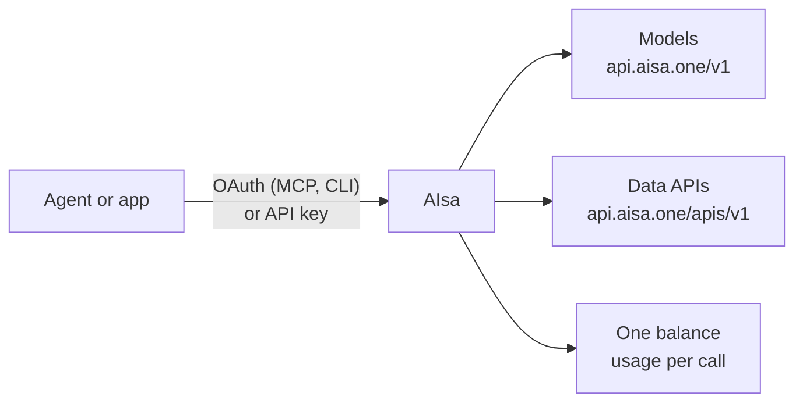

AIsa sits between your agent or application and the upstream model and data providers. You authenticate once, send requests to an AIsa endpoint, and every call is billed against a single shared balance.

## 1. Authenticate

| Connection method | Credential | How to get it |
| --- | --- | --- |
| MCP (`https://mcp.aisa.one/mcp`) | Browser OAuth: approve once when prompted | Handled automatically by your MCP client |
| AIsa CLI | Browser OAuth via `aisa login`, or `AISA_API_KEY` for CI | Run `aisa login` in your terminal |
| Direct HTTP / SDKs | API key passed as `Authorization: Bearer $AISA_API_KEY` | Create in [Console → API Keys](https://console.aisa.one/api-keys) |

Every credential draws from the same account balance. See [Authentication](/guides/authentication) for key management and OAuth details.

## 2. Call an endpoint

| Surface | Base URL | What it's for |
| --- | --- | --- |
| Models | `https://api.aisa.one/v1` | OpenAI Chat Completions, Responses, Anthropic Messages, embeddings, images, video |
| Gemini-compatible models | `https://api.aisa.one/v1beta` | Gemini `generateContent` format |
| Data APIs | `https://api.aisa.one/apis/v1` | Search, finance, social, SEO, sales, and other data providers |
| MCP | `https://mcp.aisa.one/mcp` | AI agents: search the catalog and run tools through a single connector |

Endpoint definitions and parameters follow the [OpenAPI specification](https://aisa.one/openapi.yaml).

Through MCP, an agent uses 5 core tools instead of loading hundreds into its context: `search` and `list_categories` to discover tools, `get_details` to inspect inputs and quotes, and `use` (or `batch_use` for up to 20 calls) to execute them.

## 3. Pay per use

- **One balance:** Models, data APIs, MCP calls, and the CLI all draw from the same prepaid wallet. Top up in [Console → Billing](https://console.aisa.one/billing).
- **Models** are billed per token (input, output, and cached tokens when reported by the provider).
- **Data APIs** are billed per request: either a fixed price per call, or metered by what the request consumes (results, rows, pages, or provider credits).
- **Discovery is free:** Browsing docs, listing models via `/v1/models`, and MCP discovery (`search`, `list_categories`, `get_details`) cost nothing. You only pay for executed calls.
- **Spend controls:** Set a spending limit on each key in the Console; that is the hard ceiling. On endpoints that declare maximum-price support, pass a maximum via `X-AISA-Max-Price-USD` (or `max_price_usd` in MCP `use`): the gateway rejects the call before any provider is called if the estimate is higher. This checks the estimate and does not cap the final charge. Model routes do not apply it; bound them with `max_tokens` and the key's limit.

Current rates are published at [aisa.one/models](https://aisa.one/models) and [aisa.one/api](https://aisa.one/api). For detailed billing rules, see [Billing & Credits](/guides/pricing). Selected endpoints also accept the x402 machine-payment protocol; see [Machine payments for agents](/concepts/machine-payments-for-agents).

## What AIsa handles vs. what you own

| AIsa handles | Your application owns |
| --- | --- |
| Single credential and billing across providers | User intent, authorization, and approving spend |
| Routing to the selected model or data provider | Business logic and application state |
| Normalized, documented endpoint contracts | Validating results before completing tasks |
| Usage metering and per-call cost reporting | Retry policies and idempotency for side effects |
| Machine-readable discovery (OpenAPI, Agent Card, `llms.txt`) | Secure storage of secrets and user data |

Treat state-changing operations (creating, updating, deleting data, or spending funds) with extra care: use scoped keys, require explicit user confirmation when needed, and avoid automatic retry loops on failed calls.

## When to use AIsa

AIsa is ideal when your agent or application needs multiple providers: mixing LLM reasoning with live data, switching between model families, or accessing multiple data sources without managing separate contracts.

If your workload only ever uses a single model provider and you already have an existing billing relationship with them, connecting to that provider directly may be simpler.

## Next steps

<CardGroup cols={2}>
  <Card title="Connect via MCP" icon="plug" href="/agent-quickstart">
    Set up AIsa for your agent in three quick steps.
  </Card>
  <Card title="API Key & First Call" icon="key" href="/guides/getting-started-with-aisa">
    Make your first request with curl.
  </Card>
</CardGroup>
