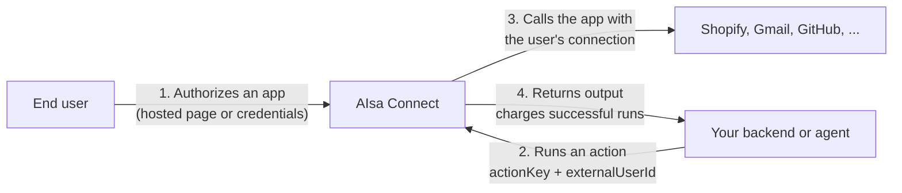

AIsa Connect lets your end users, for example the merchants you serve, connect their own app accounts such as Shopify, WooCommerce, GitHub or Google to AIsa. With one AIsa API key you then browse the app catalog and run app actions for those users: read orders, update products, list repositories and so on. AIsa's app integration holds the end users' tokens and keys, so your system does not store them and cannot read them back.

All AIsa accounts can use AIsa Connect with their existing API key and balance. No separate sign-up is needed.

## When to use it

- Your product acts inside apps that **your users** own, and you do not want to build and maintain an OAuth app or a credential vault for each one.
- You want one catalog of apps and actions, each with a JSON Schema for its input, instead of one SDK per app.
- You want to pay only for actions that succeed, from the same balance as your models and data APIs.
- Your AI agent needs to read or act in a user's account, for example their Gmail, Search Console or Shopify store, through tools it can discover at run time.

To read public data that needs no user account, such as marketplace listings, use the [Data APIs](/resources/data-apis) instead. For one request shape across social and ad platforms, see [Unified APIs](/resources/unified-apis).

## Example use cases

| You are building | What AIsa Connect does |
| --- | --- |
| An operations assistant for Shopify merchants | Each merchant connects their store once; your agent lists unfulfilled orders with `shopify.list_orders` and checks stock with `shopify.get_inventory_quantities` |
| An SEO reporting tool | Each customer authorizes Google Search Console; your backend reads performance data for their properties |
| An inbox or support copilot | Each user authorizes Gmail; your agent searches their threads with `gmail.search_threads` |
| An internal agent in Claude Code, Cursor or Codex | You connect your own accounts in the Console and the agent runs actions through the AIsa MCP server |

## How it works

<Steps>
  <Step title="Pick an app and an action">
    Search the catalog for the app, read its `authTypes`, and look up the action's `inputSchema`. Browsing is free. See [Running actions](/resources/aisa-connect/actions#discover-apps-and-actions).
  </Step>
  <Step title="Connect the end user's account">
    For `api_key` and `custom_credential` apps, collect the fields in your UI and send them to AIsa. For `oauth2` apps, send the user to the AIsa hosted page and poll the session. See [Authorizing end users](/resources/aisa-connect/authorize-users).
  </Step>
  <Step title="Run actions">
    Call `POST /actions/run` with the action key, the `externalUserId` and an `input` that matches the schema. See [Running actions](/resources/aisa-connect/actions).
  </Step>
</Steps>

## Key concepts

| Concept | Meaning |
| --- | --- |
| **End user** (`externalUserId`) | A user in **your** system, identified by your own ID. You do not register it with AIsa first. |
| **App** | An app your end users can connect, such as `shopify` or `github`. `authTypes` says how it connects. |
| **Action** | Something an app can do, keyed `<app>.<action name>`, such as `shopify.get_shop`. Each action has an `operationType` and an `inputSchema`. |
| **Connection** (`con_…`) | One app account that one end user connected. It belongs to your AIsa account plus that `externalUserId`. |
| **Connect session** (`cs_…`) | One run of the hosted OAuth flow. It expires after 30 minutes. |
| **Run** (`run_…`) | One execution of an action for an end user. Only successful runs are charged. |

[Concepts](/resources/aisa-connect/concepts) explains each one, including who owns a connection and how scopes work.

## API at a glance

Paths are relative to `https://api.aisa.one/apis/v1/connector`. Authenticate with `Authorization: Bearer YOUR_AISA_API_KEY` (or `x-api-key`), or with an MCP or CLI OAuth sign-in.

| Endpoint | Reference | Charge |
| --- | --- | --- |
| `GET /apps` | [List apps](/api-reference/aisa-connector/get_aisa_connector_apis_v1_connector_apps) | Free |
| `GET /apps/{app}/actions` | [List the actions of an app](/api-reference/aisa-connector/get_aisa_connector_apis_v1_connector_apps_app_actions) | Free |
| `GET /actions/{actionKey}` | [Get an action](/api-reference/aisa-connector/get_aisa_connector_apis_v1_connector_actions_actionkey) | Free |
| `POST /connect/{app}/credentials` | [Connect an app account with credentials](/api-reference/aisa-connector/post_aisa_connector_apis_v1_connector_connect_app_0fbeef) | Free |
| `GET /connect/{app}` | [Start a hosted connect](/api-reference/aisa-connector/get_aisa_connector_apis_v1_connector_connect_app) | Free |
| `GET /connect/sessions/{sessionId}` | [Get a connect session](/api-reference/aisa-connector/get_aisa_connector_apis_v1_connector_connect_sess_bfc4e5) | Free |
| `GET /connections` | [List connections](/api-reference/aisa-connector/get_aisa_connector_apis_v1_connector_connections) | Free |
| `GET /connections/{connectionId}` | [Get a connection](/api-reference/aisa-connector/get_aisa_connector_apis_v1_connector_connections__b41217) | Free |
| `DELETE /connections/{connectionId}` | [Disconnect a connection](/api-reference/aisa-connector/delete_aisa_connector_apis_v1_connector_connectio_b41217) | Free |
| `POST /actions/run` | [Run an action](/api-reference/aisa-connector/post_aisa_connector_apis_v1_connector_actions_run) | Successful runs only |

## What is not available yet

AIsa Connect covers the flows on these pages. The following are **not** available today:

- **Triggers and webhooks.** AIsa does not notify you when something happens in an app, or when a connect session finishes. Poll the session instead.
- **Your own OAuth app.** Hosted OAuth always uses AIsa's app registration; you cannot bring your own client ID or brand the consent screen.
- **Custom branding of the hosted page.**
- **Per-action permissions.** A key can be limited to read-only Connect access (see [Concepts](/resources/aisa-connect/concepts#scopes)), but not to individual apps or actions.
- **Team sharing.** Connections belong to the AIsa account that owns the API key; there is no separate sharing model.
- **Write access to Google apps.** Google apps connect with read-only access in production. See [Security & data handling](/resources/aisa-connect/security#app-permissions).

If you need one of these, tell us at [developer@aisa.one](mailto:developer@aisa.one).

## Next steps

<CardGroup cols={2}>
  <Card title="Quickstart" icon="rocket" href="/resources/aisa-connect/quickstart">
    Connect a test account and run your first action in about five minutes.
  </Card>
  <Card title="Use with agents" icon="robot" href="/resources/aisa-connect/agents">
    Call Connect from MCP clients, or turn actions into tools for OpenAI, Anthropic, Vercel AI SDK and LangChain.
  </Card>
  <Card title="Authorizing end users" icon="user-check" href="/resources/aisa-connect/authorize-users">
    The hosted OAuth page, credential-based apps and reconnecting.
  </Card>
  <Card title="Pricing & limits" icon="credit-card" href="/resources/aisa-connect/pricing-and-limits">
    What is charged, the connection limit and rate limits.
  </Card>
</CardGroup>
