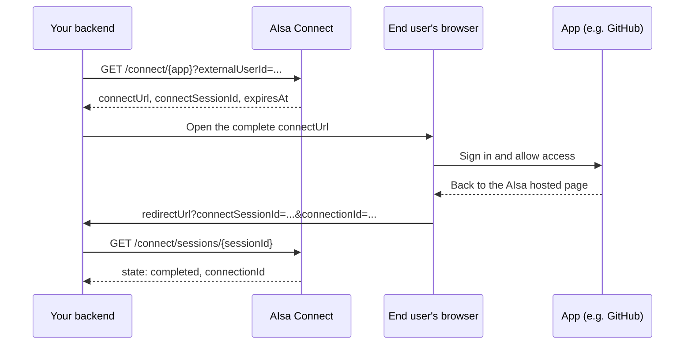

Examples on this page use `AISA_BASE=https://api.aisa.one/apis/v1/connector` and your key in `AISA_API_KEY`, as set up in the [Quickstart](/resources/aisa-connect/quickstart#before-you-start).

Before you can run actions for an end user, they connect their app account. How depends on the app's `authTypes`:

| `authTypes` value | How to connect |
| --- | --- |
| `api_key`, `custom_credential` | [Connect with credentials](#connect-with-credentials) |
| `oauth2` | [Hosted OAuth page](#hosted-oauth-page) |

Read `authTypes` from `GET /apps` or `GET /apps?q=...`. Some apps list more than one type. Shopify lists `oauth2` too, but connect it with credentials (its Admin API access token): hosted OAuth is not set up for Shopify.

## Hosted OAuth page

For `oauth2` apps, AIsa hosts the authorization page. Your backend starts a connect session, the end user authorizes in their browser, and your backend polls the session until it ends.



### Start a connect session

```bash
curl -s -G "$AISA_BASE/connect/github" \
  -H "Authorization: Bearer $AISA_API_KEY" \
  --data-urlencode "externalUserId=store_8812" \
  --data-urlencode "redirectUrl=https://app.example.com/aisa/done"   # optional
```

| Query parameter | Required | Meaning |
| --- | --- | --- |
| `externalUserId` | Yes | The end user who connects. See [End users](/resources/aisa-connect/concepts#end-users) |
| `redirectUrl` | No | Where the browser goes when the flow ends. See [Return to your app](#return-to-your-app) |
| `connectionId` | No | Reauthorize this existing connection instead of creating a new one. See [Reconnect](#reconnect-a-connection) |

```json
{
  "connectUrl": "https://.../connect/cs_...#<secret>",
  "connectSessionId": "cs_...",
  "expiresAt": "..."
}
```

<Steps>
  <Step title="Open the complete connectUrl">
    Open the **complete** `connectUrl` in the end user's browser. The part after `#` is the session secret: do not cut it off, and do not write it to logs. The session expires after 30 minutes.
  </Step>
  <Step title="The user authorizes the app">
    When the flow ends, the browser goes to `redirectUrl` with `?connectSessionId=cs_...&connectionId=con_...`, plus `&error=<code>` on failure. Without `redirectUrl`, the user stays on AIsa's result page.
  </Step>
  <Step title="Poll the session from your server">
    The session is the source of truth. Poll it every 2–3 seconds until `state` is `completed`, `failed` or `expired`:

    ```bash
    curl -s "$AISA_BASE/connect/sessions/cs_..." \
      -H "Authorization: Bearer $AISA_API_KEY"
    ```

    ```json
    { "id": "cs_...", "app": "github", "state": "completed", "connectionId": "con_...", "expiresAt": "..." }
    ```

    A failed or expired session also has `"error": {"code": "connect_denied", "message": "...", "isUserFixable": true}`, and `connectionId` stays `null`.
  </Step>
</Steps>

AIsa sends no webhook when a session ends, so polling is the only way to learn the result from your server.

### Session states and outcomes

Session states are `created`, `authorizing`, `completed`, `failed` and `expired`. The first two mean the flow is still running.

| Outcome | `state` | `error.code` |
| --- | --- | --- |
| Connected | `completed` | none; `connectionId` is set |
| The user did not grant access | `failed` | `connect_denied` |
| The app's authorization link (valid about 10 minutes) ran out before the user finished | `failed` | `connect_expired` |
| The user signed in to a different account while reauthorizing | `failed` | `connect_account_mismatch` |
| Your account reached its connection limit | `failed` | `user_quota_exceeded` |
| The connection could not be completed for another reason | `failed` | `connect_failed` |
| The 30-minute session ran out | `expired` | `connect_failed` |

`error.isUserFixable` is `true` when the end user can fix the problem by trying again, for example after declining access. `error.message` is a short explanation you can show to the end user. Handle the outcome by `error.code`, not by the message text.

AIsa creates the connection only after it confirms with the app that authorization finished. The parameters on the redirect are not trusted on their own, so you do not need to forward them to AIsa. If the user returns before the app has recorded the authorization, the hosted page checks again for about 10 seconds; if the user comes back without finishing, the page sends them back to the app's authorization screen.

### Return to your app

`redirectUrl` is optional. When you send it, it must:

- be an absolute `https://` URL, at most 2048 bytes, without a `#fragment`, without a user name or password, and without `.` or `..` path segments;
- start with a URL prefix on your account's redirect allowlist. A prefix matches on the same host and at a `/` boundary, so `https://app.example.com/aisa` allows `https://app.example.com/aisa/done` but not `https://app.example.com/aisa-old`.

To add a URL prefix to the allowlist, send it to [developer@aisa.one](mailto:developer@aisa.one). A `redirectUrl` that breaks these rules is refused with `400 invalid_request` when you start the session.

Query parameters you put in `redirectUrl` are kept as they are. AIsa appends `connectSessionId`, then `connectionId` on success or `error=<code>` on failure. Treat them as a hint to look up the session, not as proof of the result.

### What the end user sees

The hosted page is AIsa's. It shows **Connect your app account**, then **Preparing the connection…** and **Redirecting to the app…** while it sends the user to the app's own sign-in and consent screens. When the user comes back it shows **Finishing the connection…**, then either returns them to your `redirectUrl` or shows a result page: **App account connected** ("You can close this window and return to the app.") or **Connection failed**, with a reason the user can act on and a **Try again** button.

### Customizing and embedding

- The hosted page's branding and wording cannot be customized yet.
- Open `connectUrl` as a top-level page: a new tab, a popup window, or a redirect of the current tab. Most apps' sign-in screens, including Google's, refuse to load inside an iframe.
- A link is for one end user and one app. Do not share it, and start a new session for every attempt.

### Errors when starting a session

| HTTP | `code` | Cause |
| --- | --- | --- |
| 400 | `invalid_request` | A bad `externalUserId`, app key or `redirectUrl` (`param` says which), or a `connectionId` of another app |
| 404 | `not_found` | The app is not in the catalog, or the `connectionId` is not one of this end user's connections |
| 403 | `user_quota_exceeded` | Your account already has its maximum of active connections |
| 409 | `reconnect_required` | The app cannot reauthorize this connection in place; connect again without `connectionId` |

## Reconnect a connection

When a connection is `needs_reconnect`, or a run fails with `reconnect_required`, start a session again with the same `externalUserId` and `connectionId=con_...`:

```bash
curl -s -G "$AISA_BASE/connect/github" \
  -H "Authorization: Bearer $AISA_API_KEY" \
  --data-urlencode "externalUserId=store_8812" \
  --data-urlencode "connectionId=con_..."
```

- The existing connection is updated in place and keeps its ID, so nothing in your backend changes.
- The connection must belong to that end user and that app. A connection of another app returns `400 invalid_request` with `param: "connectionId"`.
- If the app cannot reauthorize in place, starting the session returns `409 reconnect_required`. Connect again without `connectionId`, then delete the old connection.
- If the user signs in to a different account than the one being reconnected, the session fails with `connect_account_mismatch` and the connection is set to `needs_reconnect` until the user reauthorizes the original account.
- A reconnect does not count against your connection limit.

Starting a session **without** `connectionId` for an end user who already has a connection to the app can add another connection, which counts against your limit. To repair access, reconnect with `connectionId` instead.

## Connect with credentials

Most commerce apps, including Shopify and WooCommerce, connect with credentials. Ask the end user for the fields the app takes, then forward them to AIsa in `credentials`. `apiKey` can also be sent at the top level; it is the same as `credentials.apiKey`.

<CodeGroup>

```bash Shopify (api_key)
curl -s -X POST "$AISA_BASE/connect/shopify/credentials" \
  -H "Authorization: Bearer $AISA_API_KEY" \
  -H "Content-Type: application/json" \
  -d '{
    "externalUserId": "store_8812",
    "apiKey": "<ADMIN_API_ACCESS_TOKEN>",
    "credentials": { "shopDomain": "acme.myshopify.com" }
  }'
```

```bash WooCommerce (custom_credential)
curl -s -X POST "$AISA_BASE/connect/woocommerce/credentials" \
  -H "Authorization: Bearer $AISA_API_KEY" \
  -H "Content-Type: application/json" \
  -d '{
    "externalUserId": "store_8812",
    "credentials": {
      "storeUrl": "https://shop.example.com",
      "consumerKey": "ck_...",
      "consumerSecret": "cs_..."
    }
  }'
```

</CodeGroup>

- **Shopify** takes the store's Admin API access token (`shpat_…`) as `apiKey`, and the store's myshopify.com domain as `shopDomain`, such as `acme.myshopify.com`. The Shopify admin URL of the same store is also accepted.
- **WooCommerce** requires `storeUrl` (the HTTPS store address), `consumerKey` and `consumerSecret`. `wordpressUsername` and `wordpressApplicationPassword` are optional; some WordPress endpoints need them.
- **Apps that take one key**, such as OpenAI, need only `"apiKey": "..."`.
- **Other apps.** The catalog does not list credential field names yet. Take them from the app's `documentationUrl`, or ask us at [developer@aisa.one](mailto:developer@aisa.one).

A successful connect returns the new connection with `200`:

```json
{
  "id": "con_...",
  "app": "shopify",
  "externalUserId": "store_8812",
  "status": "active",
  "scopes": [],
  "connectedAt": "2026-11-12T08:00:00Z",
  "updatedAt": "2026-11-12T08:00:00Z"
}
```

### How credentials are checked

1. **AIsa checks the request first.** A missing required field, or a field the app does not take, returns `400 invalid_request` with `param: "credentials"` and the message "the credentials are not the fields the app takes: a required one is missing or one is not the app's". For an `api_key` app without `apiKey`, `param` is `apiKey`. Nothing is created.
2. **The app then checks the credentials themselves.** A wrong token, a shop domain that is not a myshopify.com domain, or a WooCommerce address that is not HTTPS returns `400 connect_failed`. Ask the user to check what they entered.

Other rules:

- Send `apiKey` once: at the top level **or** in `credentials`, not both. Sending no credentials at all is also `400 invalid_request`.
- `credentials` holds at most 16 fields. Names are at most 64 bytes, and values are non-empty strings of at most 4096 bytes.
- Unknown fields in the request body are rejected with `400 invalid_request`.
- An app that is not in the catalog returns `404 not_found`. An app that only supports OAuth returns `400 invalid_request` with `param: "app"`; use the [hosted page](#hosted-oauth-page) instead.
- The app checks the credentials at connect time, so a credential connect needs a positive balance, even though it is free. Otherwise it returns `402 insufficient_balance`.
- A new connection counts against your [connection limit](/resources/aisa-connect/pricing-and-limits#connection-limit). Over it, the request returns `403 user_quota_exceeded`.
- AIsa does not store, log or return the credentials you send, and error messages never contain credential values. Your backend should not store or log them either.
