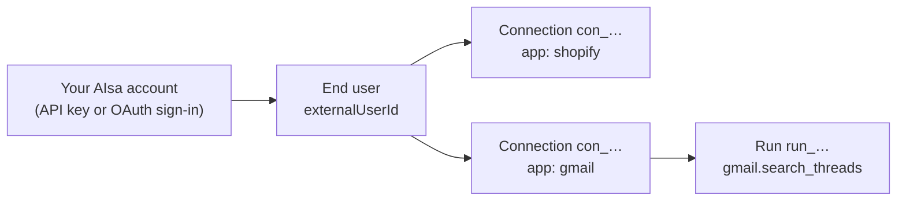

AIsa Connect has a small object model. Your **end users** create **connections** to **apps**, through a **connect session** or with credentials, and you run an app's **actions** with those connections.



| Concept | Meaning |
| --- | --- |
| **End user** (`externalUserId`) | A user in **your** system, identified by your own ID. You do not register it with AIsa first. |
| **App** | An app your end users can connect, such as `shopify` or `github`. `authTypes` says how it connects. |
| **Action** | Something an app can do, keyed `<app>.<action name>`, such as `shopify.get_shop`. Each action has an `operationType` and an `inputSchema`. |
| **Connection** (`con_…`) | One app account that one end user connected. It belongs to your AIsa account plus that `externalUserId`. |
| **Connect session** (`cs_…`) | One run of the hosted OAuth flow. It expires after 30 minutes. |
| **Run** (`run_…`) | One execution of an action for an end user. Only successful runs are charged. |

## End users

`externalUserId` is the ID of the end user **in your system**. AIsa uses it to keep your end users apart.

- **Format:** 1–250 printable ASCII characters, with no leading or trailing spaces. Use a stable ID that contains no personal data, such as `store_8812`. Do not use an email address.
- **Where it is required:** starting a connection and running an action. When listing connections it is an optional filter, matched exactly (case-sensitive).
- **Isolation:** a connection belongs to your AIsa account **and** one `externalUserId`. When user A runs an action, AIsa never uses user B's connection.
- **No registration.** AIsa keeps no end user record of its own; the ID is stored on each connection. There is no endpoint to create, list or delete end users; list their connections instead.

<Warning>
`GET /connections/{connectionId}` and `DELETE /connections/{connectionId}` only check that the connection belongs to **your AIsa account**. They do not check the end user. Keep the mapping from connection to end user in your backend, and never let an end user pass in an arbitrary connection ID.
</Warning>

## Apps

An app is something an end user can connect, such as `shopify`, `github`, `gmail` or `google_search_console`. App keys are lowercase letters, digits, `_` and `-`.

| Field | Meaning |
| --- | --- |
| `key` | The app key used in paths and action keys |
| `name`, `description` | Display name and summary |
| `aliases` | Other names the app is known by; `q` searches them |
| `categories` | `{id, name}` pairs |
| `authTypes` | How the app connects: `oauth2`, `api_key` or `custom_credential` |
| `iconUrl`, `homepageUrl`, `documentationUrl` | Links for your UI. `iconUrl` can be `null` |

The catalog leaves out apps that need no user account, and platforms that AIsa serves through its own APIs, such as X (Twitter), Instagram, LinkedIn, Reddit, YouTube, Meta, TikTok for Business and Google Ads. Use the [Unified APIs](/resources/unified-apis) for those.

## Actions

An action is one operation an app offers, keyed `<app>.<action name>`, for example `shopify.list_orders` or `gmail.search_threads`.

| Field | Meaning |
| --- | --- |
| `key`, `app`, `name`, `description` | Identity and summary |
| `operationType` | `read`, `write` or `destructive` |
| `requiredScopes` | The app permissions the action needs, as the app names them |
| `inputSchema` | JSON Schema (draft 2020-12) for `input` on a run |
| `outputSchema` | JSON Schema for `output` on a successful run |

The catalog lists every action an app offers. Whether a run succeeds also depends on what the connected account allows. See [Running actions](/resources/aisa-connect/actions).

## Connections

A connection is one app account that one end user connected. You get it back from a credential connect, or as `connectionId` on a completed connect session.

```json
{
  "id": "con_...",
  "app": "shopify",
  "externalUserId": "store_8812",
  "status": "active",
  "scopes": [],
  "connectedAt": "2026-11-12T08:00:00Z",
  "updatedAt": "2026-11-12T08:00:00Z"
}
```

- `status` is `active`, `needs_reconnect` or `disconnected`. See [Managing connections](/resources/aisa-connect/connections#connection-status).
- `scopes` lists the permissions the app reported for the authorization. It can be empty, for example for credential-based apps.
- An end user can have connections to several apps. If an end user has more than one connection to the same app, a run without `connectionId` uses the newest `active` one.

## Connect sessions

A connect session (`cs_…`) is one run of the hosted OAuth flow for one end user and one app. You start it, send the user to its `connectUrl`, and poll it until it ends. It expires after 30 minutes. See [Authorizing end users](/resources/aisa-connect/authorize-users#hosted-oauth-page).

## Hosted OAuth vs credentials

| | Hosted OAuth (`oauth2`) | Credentials (`api_key`, `custom_credential`) |
| --- | --- | --- |
| Who enters what | The end user signs in to the app on AIsa's hosted page | The end user gives your UI a key or credentials, and your backend forwards them |
| Calls | `GET /connect/{app}`, then poll `GET /connect/sessions/{sessionId}` | One `POST /connect/{app}/credentials` |
| Your code sees secrets | Never | Only in transit, when you forward them. Do not store or log them |
| Examples | GitHub, Gmail, Google Search Console | Shopify (Admin API token), WooCommerce, OpenAI |

Some apps support more than one auth type. `authTypes` on the app tells you which.

## Ownership

Everything in AIsa Connect belongs to the **AIsa account that owns the API key**:

- All API keys of the same account see the same connections, and so does an MCP or CLI client signed in with OAuth as that account.
- Accounts are fully separate: one AIsa account can never see or use another account's connections.
- Connections you make in the [Console](/resources/aisa-connect/console) belong to the same account, under the end user ID `console-user-<your user id>`.
- There is no team sharing or per-member permission model for connections yet.

## Authentication

Send one of these on every request:

- `Authorization: Bearer YOUR_AISA_API_KEY`, or `x-api-key: YOUR_AISA_API_KEY`. See [Authentication](/guides/authentication) for creating, limiting and rotating keys.
- An OAuth access token from MCP or CLI sign-in, sent the same way as on social and other MCP-backed routes. MCP clients that signed in with OAuth do not need a key.

Use an API key only from your backend. Never put an API key in a browser or mobile app.

## Scopes

AIsa Connect has two scopes:

| Scope | Allows |
| --- | --- |
| `connector:read` | Browsing apps and actions, reading connect sessions, listing and reading connections |
| `connector:write` | Running actions, starting connections (hosted or with credentials), deleting connections |

By default an API key has both. To limit a key to read-only Connect access, contact [developer@aisa.one](mailto:developer@aisa.one); there is no Console setting for it yet. A request without the scope it needs fails with `403 insufficient_scope`, and `error.details.requiredScope` names the scope. A personal MCP or CLI sign-in has the same Connect scopes as your account's MCP key, so both by default. An OAuth sign-in for an organization can always read, but runs actions, starts connections and deletes connections only when its token was granted `connector:write`.

Scopes are AIsa's permissions for the API. They are different from the app permissions an end user grants during OAuth, which decide what the app lets a run do.
