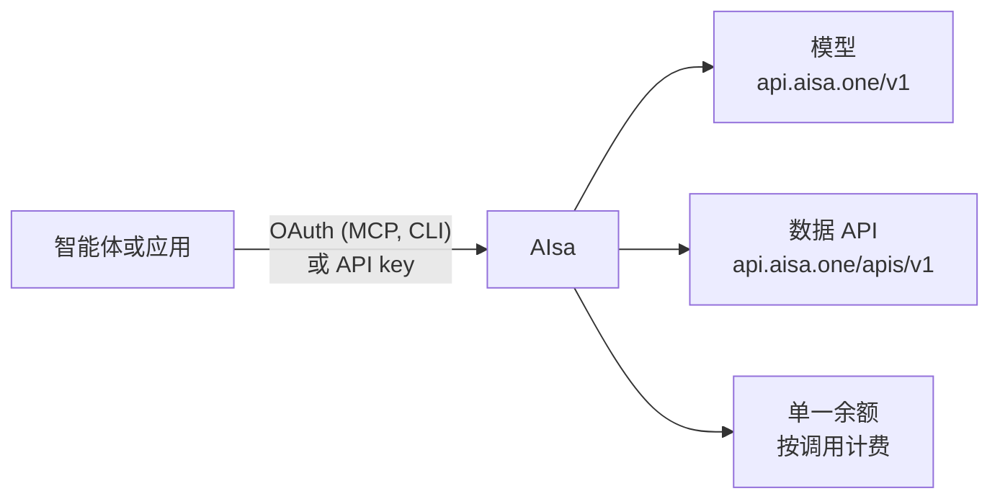

AIsa 位于你的智能体或应用与上游模型及数据提供商之间。你只需认证一次，向 AIsa 端点发送请求，所有调用都从同一个共享余额中扣费。

## 1. 认证

| 连接方式 | 凭证 | 获取方式 |
| --- | --- | --- |
| MCP (`https://mcp.aisa.one/mcp`) | 浏览器 OAuth：首次提示时批准一次即可 | 由你的 MCP 客户端自动处理 |
| AIsa CLI | 通过 `aisa login` 完成浏览器 OAuth，或在 CI 中使用 `AISA_API_KEY` | 在终端中运行 `aisa login` |
| 直接 HTTP / SDK | API key，通过 `Authorization: Bearer $AISA_API_KEY` 传递 | 在[控制台 → API Keys](https://dev-console.aisa.one/api-keys) 中创建 |

所有凭证共享同一个账户余额。密钥管理和 OAuth 细节见[认证](/zh/guides/authentication)。

## 2. 调用端点

| 类型 | Base URL | 用途 |
| --- | --- | --- |
| 模型 | `https://dev-api.aisa.one/v1` | OpenAI Chat Completions、Responses、Anthropic Messages、embeddings、images、video |
| Gemini 兼容模型 | `https://dev-api.aisa.one/v1beta` | Gemini `generateContent` 格式 |
| 数据 API | `https://dev-api.aisa.one/apis/v1` | 搜索、金融、社交、SEO、销售及其他数据提供商 |
| MCP | `https://mcp.aisa.one/mcp` | AI 智能体：通过单一连接器搜索目录并运行工具 |

端点定义和参数遵循 [OpenAPI 规范](https://raw.githubusercontent.com/AIsa-team/docs/refs/heads/dev/openapi.yaml)。

通过 MCP，智能体使用少量元工具即可工作，无需将数百个工具加载到上下文中：`search` 和 `list_categories` 用于发现工具，`get_details` 用于查看输入参数，`batch_quote` 用于获取精确调用的报价，`batch_use` 用于一次执行最多 20 个调用。

## 3. 按用量付费

- **单一余额：** 模型、数据 API、MCP 调用和 CLI 都从同一个预付钱包中扣费。在[控制台 → Billing](https://dev-console.aisa.one/billing) 充值。
- **模型**按 token 计费（包括输入、输出以及提供商报告的缓存 token）。
- **数据 API** 按请求计费：要么每次调用固定价格，要么根据请求消耗的内容（结果数、行数、页数或提供商额度）按量计费。
- **发现免费：** 浏览文档、通过 `/v1/models` 列出模型，以及 MCP 发现和报价（`search`、`list_categories`、`get_details`、`batch_quote`）不产生任何费用。你只需为实际执行的调用付费。
- **消费控制：** 在控制台中为每个 key 设置消费限额，这是硬性上限。对于声明支持最高价格的端点，通过 `X-AISA-Max-Price-USD` 传入上限：如果预估价格超出，网关会在调用任何提供商之前拒绝该请求。通过 MCP，`batch_quote` 会在 `batch_use` 执行之前显示预估费用。两者都检查预估值，但不会限制最终实际费用。模型路由不适用此机制；请使用 `max_tokens` 和 key 的限额来约束模型消费。

当前费率发布在 [aisa.one/models](https://aisa.one/models) 和 [aisa.one/api](https://aisa.one/api)。详细计费规则请参阅[计费与额度](/zh/guides/pricing)。部分数据端点还支持通过 Machine Payments Protocol (MPP) 进行按请求付款，无需 API key；详见 [Machine Payments](/zh/integrations/machine-payments)。

## AIsa 负责什么 vs. 你负责什么

| AIsa 负责 | 你的应用负责 |
| --- | --- |
| 跨提供商的统一凭证和计费 | 用户意图、授权和批准消费 |
| 路由到所选模型或数据提供商 | 业务逻辑和应用状态 |
| 标准化、文档化的端点契约 | 在完成任务前验证结果 |
| 用量计量和按调用的费用报告 | 重试策略和副作用的幂等性 |
| 机器可读的发现机制（OpenAPI、Agent Card、`llms.txt`） | 密钥和用户数据的安全存储 |

对于有状态变更的操作（创建、更新、删除数据或花费资金）需格外谨慎：使用范围受限的 key，必要时要求用户明确确认，避免对失败调用自动循环重试。

## 何时使用 AIsa

当你的智能体或应用需要多个提供商时，AIsa 是理想选择：将 LLM 推理与实时数据混合使用、在不同模型系列之间切换，或在无需管理多份合同的情况下访问多个数据源。

如果你的工作负载始终只使用单一模型提供商，且你已与其建立了计费关系，直接连接该提供商可能更简单。

## 下一步

<CardGroup cols={2}>
  <Card title="通过 MCP 连接" icon="plug" href="/zh/agent-quickstart">
    三步快速为你的智能体设置 AIsa。
  </Card>
  <Card title="API Key 与首次调用" icon="key" href="/zh/guides/getting-started-with-aisa">
    用 curl 发起你的第一个请求。
  </Card>
</CardGroup>
