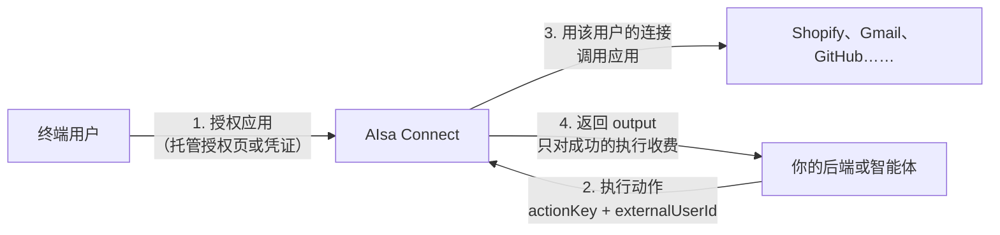

AIsa Connect 让你的终端用户（例如你服务的商家）把自己的 Shopify、WooCommerce、GitHub、Google 等应用账号连接到 AIsa。之后你只用一个 AIsa API Key，就能浏览应用目录，并代表这些用户执行应用动作：查订单、改商品、列仓库等。终端用户的令牌和密钥由 AIsa 的应用集成保管，你的系统不用存，也读不到。

所有 AIsa 账户都可以直接使用 AIsa Connect，用的就是你现有的 API Key 和余额，不需要单独开通。

## 适用场景

- 你的产品要在**你的用户**自己的应用账号里做事，又不想为每个应用分别开发 OAuth 应用、维护凭证库。
- 你想要一份统一的应用和动作目录，每个动作都带输入的 JSON Schema，而不是每个应用接一套 SDK。
- 你只想为执行成功的动作付费，并且和模型、数据 API 共用一个余额。
- 你的 AI 智能体需要读取或操作用户自己的账号，例如 Gmail、Search Console 或 Shopify 店铺，并且要在运行时自己发现可用的工具。

如果只是读取不需要用户账号的公开数据（例如电商平台商品），请用[数据 API](/zh/resources/data-apis)。要用一种请求格式覆盖多个社媒和广告平台，见 [Unified API](/zh/resources/unified-apis)。

## 典型用例

| 你在做的产品 | AIsa Connect 帮你做什么 |
| --- | --- |
| 面向 Shopify 商家的运营助手 | 每个商家连接一次店铺，你的智能体用 `shopify.list_orders` 列出未发货订单，用 `shopify.get_inventory_quantities` 查库存 |
| SEO 报表工具 | 每个客户授权 Google Search Console，你的后端读取他们站点的搜索表现数据 |
| 邮箱或客服副驾 | 每个用户授权 Gmail，你的智能体用 `gmail.search_threads` 搜索他们的邮件会话 |
| 在 Claude Code、Cursor 或 Codex 里用的内部智能体 | 你在控制台连接自己的账号，智能体通过 AIsa MCP 服务器执行动作 |

## 工作原理

<Steps>
  <Step title="选定应用和动作">
    在目录里搜索应用，查看它的 `authTypes`，再查看动作的 `inputSchema`。浏览目录免费。见[执行动作](/zh/resources/aisa-connect/actions#发现应用和动作)。
  </Step>
  <Step title="连接终端用户的账号">
    `api_key` 和 `custom_credential` 类应用：在你的界面里收集字段，转交给 AIsa。`oauth2` 类应用：把用户带到 AIsa 托管授权页，再轮询会话。见[为终端用户授权](/zh/resources/aisa-connect/authorize-users)。
  </Step>
  <Step title="执行动作">
    调用 `POST /actions/run`，带上动作 key、`externalUserId` 和符合 schema 的 `input`。见[执行动作](/zh/resources/aisa-connect/actions)。
  </Step>
</Steps>

## 核心概念

| 概念 | 含义 |
| --- | --- |
| **终端用户**（`externalUserId`） | **你自己系统里**的用户，用你自己的 ID 标识，不需要事先在 AIsa 注册。 |
| **应用** | 终端用户可以连接的应用，例如 `shopify`、`github`。`authTypes` 说明它的连接方式。 |
| **动作** | 应用能做的一件事，key 的格式是 `<app>.<动作名>`，例如 `shopify.get_shop`。每个动作有 `operationType` 和 `inputSchema`。 |
| **连接**（`con_…`） | 某个终端用户连接的一个应用账号，归属于“你的 AIsa 账户 + 这个 `externalUserId`”。 |
| **连接会话**（`cs_…`） | 一次托管 OAuth 授权流程，30 分钟后过期。 |
| **执行**（`run_…`） | 为某个终端用户执行一次动作。只有执行成功才收费。 |

每个概念的详细说明，包括连接归谁所有、权限范围怎么生效，见[核心概念](/zh/resources/aisa-connect/concepts)。

## API 一览

路径都相对于 `https://api.aisa.one/apis/v1/connector`。鉴权用 `Authorization: Bearer YOUR_AISA_API_KEY`（或 `x-api-key`），也可以用 MCP 或 CLI 的 OAuth 登录。

| 端点 | 参考 | 费用 |
| --- | --- | --- |
| `GET /apps` | [应用列表](/zh/api-reference/aisa-connector/get_aisa_connector_apis_v1_connector_apps) | 免费 |
| `GET /apps/{app}/actions` | [应用的动作列表](/zh/api-reference/aisa-connector/get_aisa_connector_apis_v1_connector_apps_app_actions) | 免费 |
| `GET /actions/{actionKey}` | [单个动作](/zh/api-reference/aisa-connector/get_aisa_connector_apis_v1_connector_actions_actionkey) | 免费 |
| `POST /connect/{app}/credentials` | [用凭证连接应用账号](/zh/api-reference/aisa-connector/post_aisa_connector_apis_v1_connector_connect_app_0fbeef) | 免费 |
| `GET /connect/{app}` | [发起托管授权](/zh/api-reference/aisa-connector/get_aisa_connector_apis_v1_connector_connect_app) | 免费 |
| `GET /connect/sessions/{sessionId}` | [查询连接会话](/zh/api-reference/aisa-connector/get_aisa_connector_apis_v1_connector_connect_sess_bfc4e5) | 免费 |
| `GET /connections` | [连接列表](/zh/api-reference/aisa-connector/get_aisa_connector_apis_v1_connector_connections) | 免费 |
| `GET /connections/{connectionId}` | [查询连接](/zh/api-reference/aisa-connector/get_aisa_connector_apis_v1_connector_connections__b41217) | 免费 |
| `DELETE /connections/{connectionId}` | [删除连接](/zh/api-reference/aisa-connector/delete_aisa_connector_apis_v1_connector_connectio_b41217) | 免费 |
| `POST /actions/run` | [执行动作](/zh/api-reference/aisa-connector/post_aisa_connector_apis_v1_connector_actions_run) | 仅执行成功时收费 |

## 暂不支持的功能

AIsa Connect 覆盖本组文档里介绍的流程。以下功能目前**还不支持**：

- **触发器和 webhook。** 应用里发生了什么、连接会话什么时候结束，AIsa 都不会主动通知你。请轮询会话。
- **使用你自己的 OAuth 应用。** 托管 OAuth 始终使用 AIsa 注册的应用，不能换成你自己的 client ID，也不能给授权同意页换品牌。
- **自定义托管授权页的品牌。**
- **按动作分配权限。** 可以把 key 限制为 Connect 只读（见[核心概念](/zh/resources/aisa-connect/concepts#权限范围)），但不能限制到具体应用或动作。
- **团队共享。** 连接归属于 API Key 所在的 AIsa 账户，没有单独的共享机制。
- **Google 应用的写权限。** 生产环境里 Google 应用以只读权限连接。见[安全与数据处理](/zh/resources/aisa-connect/security#应用权限)。

需要其中某项功能，请告诉我们：[developer@aisa.one](mailto:developer@aisa.one)。

## 下一步

<CardGroup cols={2}>
  <Card title="快速开始" icon="rocket" href="/zh/resources/aisa-connect/quickstart">
    大约五分钟，连接一个测试账号并执行第一个动作。
  </Card>
  <Card title="在智能体中使用" icon="robot" href="/zh/resources/aisa-connect/agents">
    在 MCP 客户端里调用 Connect，或把动作变成 OpenAI、Anthropic、Vercel AI SDK 和 LangChain 的工具。
  </Card>
  <Card title="为终端用户授权" icon="user-check" href="/zh/resources/aisa-connect/authorize-users">
    托管 OAuth 授权页、凭证类应用和重新连接。
  </Card>
  <Card title="价格与限制" icon="credit-card" href="/zh/resources/aisa-connect/pricing-and-limits">
    哪些操作收费、连接数上限和限流。
  </Card>
</CardGroup>
