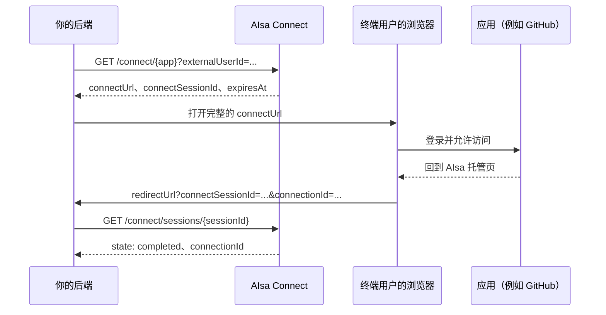

本页示例使用 `AISA_BASE=https://api.aisa.one/apis/v1/connector`，key 放在 `AISA_API_KEY` 里，设置方法见[快速开始](/zh/resources/aisa-connect/quickstart#准备)。

在为终端用户执行动作之前，他们要先连接自己的应用账号。怎么连接取决于应用的 `authTypes`：

| `authTypes` 取值 | 连接方式 |
| --- | --- |
| `api_key`、`custom_credential` | [用凭证连接](#用凭证连接) |
| `oauth2` | [托管授权页](#托管授权页) |

`authTypes` 可以从 `GET /apps` 或 `GET /apps?q=...` 读取。有些应用会列出不止一种方式。Shopify 也列出了 `oauth2`，但请用凭证（Admin API access token）连接：Shopify 没有配置托管 OAuth。

## 托管授权页

`oauth2` 类应用的授权页由 AIsa 托管。你的后端发起连接会话，终端用户在浏览器里授权，你的后端轮询会话直到结束。



### 发起连接会话

```bash
curl -s -G "$AISA_BASE/connect/github" \
  -H "Authorization: Bearer $AISA_API_KEY" \
  --data-urlencode "externalUserId=store_8812" \
  --data-urlencode "redirectUrl=https://app.example.com/aisa/done"   # optional
```

| 查询参数 | 必填 | 含义 |
| --- | --- | --- |
| `externalUserId` | 是 | 要连接的终端用户。见[终端用户](/zh/resources/aisa-connect/concepts#终端用户) |
| `redirectUrl` | 否 | 流程结束后浏览器跳转的地址。见[跳回你的应用](#跳回你的应用) |
| `connectionId` | 否 | 对这个已有连接重新授权，而不是新建连接。见[重新连接](#重新连接) |

```json
{
  "connectUrl": "https://.../connect/cs_...#<secret>",
  "connectSessionId": "cs_...",
  "expiresAt": "..."
}
```

<Steps>
  <Step title="打开完整的 connectUrl">
    在终端用户的浏览器里打开**完整的** `connectUrl`。`#` 后面是这次会话的密钥，不能截掉，也不要写进日志。会话 30 分钟后过期。
  </Step>
  <Step title="用户在应用里授权">
    流程结束后，浏览器跳到 `redirectUrl`，并带上 `?connectSessionId=cs_...&connectionId=con_...`；失败时再带 `&error=<code>`。不传 `redirectUrl` 时，用户会停在 AIsa 的结果页。
  </Step>
  <Step title="在服务端轮询会话">
    以会话状态为准。每 2–3 秒查一次，直到 `state` 是 `completed`、`failed` 或 `expired`：

    ```bash
    curl -s "$AISA_BASE/connect/sessions/cs_..." \
      -H "Authorization: Bearer $AISA_API_KEY"
    ```

    ```json
    { "id": "cs_...", "app": "github", "state": "completed", "connectionId": "con_...", "expiresAt": "..." }
    ```

    失败或过期的会话多一个 `"error": {"code": "connect_denied", "message": "...", "isUserFixable": true}`，`connectionId` 保持为 `null`。
  </Step>
</Steps>

会话结束时 AIsa 不发 webhook，所以服务端只能靠轮询拿到结果。

### 会话状态和结果

会话的 `state` 有 `created`、`authorizing`、`completed`、`failed` 和 `expired`。前两个表示流程还在进行。

| 结果 | `state` | `error.code` |
| --- | --- | --- |
| 连接成功 | `completed` | 无；`connectionId` 有值 |
| 用户没有同意授权 | `failed` | `connect_denied` |
| 用户完成授权前，应用的授权链接（约 10 分钟有效）已过期 | `failed` | `connect_expired` |
| 重新授权时用户登录了另一个账号 | `failed` | `connect_account_mismatch` |
| 你的账户有效连接数已达上限 | `failed` | `user_quota_exceeded` |
| 其他原因导致连接没有完成 | `failed` | `connect_failed` |
| 30 分钟的会话到期 | `expired` | `connect_failed` |

`error.isUserFixable` 为 `true` 表示终端用户重试就能解决，例如之前拒绝了授权。`error.message` 是可以直接展示给终端用户的简短说明。处理结果请按 `error.code`，不要按文案判断。

AIsa 会先向应用核实授权确实完成，再创建连接。跳转带回的参数不会被直接采信，所以你不需要把它们转发给 AIsa。如果用户回到托管页时应用还没记录授权完成，托管页会自动重查约 10 秒；如果用户没完成授权就返回，托管页会把他重新带回应用的授权页。

### 跳回你的应用

`redirectUrl` 可选。传了就必须满足：

- 是绝对的 `https://` URL，不超过 2048 字节，不带 `#片段`，不带用户名或密码，路径里没有 `.` 或 `..` 段；
- 以你账户跳转白名单里的某个 URL 前缀开头。前缀要求同一主机，并在 `/` 边界处匹配：`https://app.example.com/aisa` 允许 `https://app.example.com/aisa/done`，但不允许 `https://app.example.com/aisa-old`。

要把 URL 前缀加进白名单，发给 [developer@aisa.one](mailto:developer@aisa.one) 即可。不符合规则的 `redirectUrl` 在发起会话时就会被拒绝，返回 `400 invalid_request`。

你在 `redirectUrl` 里自带的查询参数会原样保留。AIsa 会在后面追加 `connectSessionId`，成功时再追加 `connectionId`，失败时追加 `error=<code>`。这些参数只用来帮你找到会话，不能当作结果的凭据。

### 终端用户看到什么

托管页是 AIsa 的页面。它先显示 **连接你的应用账号**，然后是 **正在准备连接…** 和 **正在跳转到应用…**，把用户带到应用自己的登录和授权同意页。用户回来后显示 **正在完成连接…**，接着要么跳回你的 `redirectUrl`，要么显示结果页：**应用账号已连接**（“可以关闭此窗口，回到应用。”）或 **连接失败**，附上用户能自己处理的原因和 **重试** 按钮。

### 定制和嵌入

- 托管页的品牌和文案暂时不能定制。
- 请以顶层页面打开 `connectUrl`：新标签页、弹出窗口，或者让当前标签页跳转。大多数应用的登录页（包括 Google）不允许在 iframe 里加载。
- 一个链接只对应一个终端用户和一个应用。不要分享链接，每次尝试都发起新会话。

### 发起会话时的错误

| HTTP | `code` | 原因 |
| --- | --- | --- |
| 400 | `invalid_request` | `externalUserId`、应用 key 或 `redirectUrl` 不合法（`param` 会指明是哪个），或 `connectionId` 属于别的应用 |
| 404 | `not_found` | 应用不在目录里，或 `connectionId` 不是这个终端用户的连接 |
| 403 | `user_quota_exceeded` | 你的账户有效连接数已达上限 |
| 409 | `reconnect_required` | 这个应用不支持原地重新授权该连接；不带 `connectionId` 重新连接 |

## 重新连接

连接变成 `needs_reconnect`，或者执行时返回 `reconnect_required`，就用同一个 `externalUserId` 加上 `connectionId=con_...` 再发起一次会话：

```bash
curl -s -G "$AISA_BASE/connect/github" \
  -H "Authorization: Bearer $AISA_API_KEY" \
  --data-urlencode "externalUserId=store_8812" \
  --data-urlencode "connectionId=con_..."
```

- 原连接会原地更新，ID 不变，你的后端什么都不用改。
- 连接必须属于这个终端用户和这个应用。属于别的应用时返回 `400 invalid_request`，`param` 是 `connectionId`。
- 如果应用不支持原地重新授权，发起会话时返回 `409 reconnect_required`。这时请不带 `connectionId` 重新连接，再删除旧连接。
- 如果用户登录的不是要重新连接的那个账号，会话以 `connect_account_mismatch` 失败，该连接会被置为 `needs_reconnect`，直到用户重新授权原来的账号。
- 重新连接不占用连接数上限。

如果终端用户在这个应用下已经有连接，再**不带** `connectionId` 发起会话，可能会新增一个连接，并占用上限。想修复访问权限，请带上 `connectionId` 重新连接。

## 用凭证连接

Shopify、WooCommerce 等大多数电商应用用凭证连接。在你的界面里让终端用户填写应用需要的字段，再放进 `credentials` 转交给 AIsa。`apiKey` 也可以单独写在顶层，等同于 `credentials.apiKey`。

<CodeGroup>

```bash Shopify (api_key)
curl -s -X POST "$AISA_BASE/connect/shopify/credentials" \
  -H "Authorization: Bearer $AISA_API_KEY" \
  -H "Content-Type: application/json" \
  -d '{
    "externalUserId": "store_8812",
    "apiKey": "<ADMIN_API_ACCESS_TOKEN>",
    "credentials": { "shopDomain": "acme.myshopify.com" }
  }'
```

```bash WooCommerce (custom_credential)
curl -s -X POST "$AISA_BASE/connect/woocommerce/credentials" \
  -H "Authorization: Bearer $AISA_API_KEY" \
  -H "Content-Type: application/json" \
  -d '{
    "externalUserId": "store_8812",
    "credentials": {
      "storeUrl": "https://shop.example.com",
      "consumerKey": "ck_...",
      "consumerSecret": "cs_..."
    }
  }'
```

</CodeGroup>

- **Shopify**：`apiKey` 是店铺的 Admin API access token（`shpat_…`），`shopDomain` 是店铺的 myshopify.com 域名，例如 `acme.myshopify.com`；也接受同一店铺的 Shopify 后台 URL。
- **WooCommerce**：`storeUrl`（https 店铺地址）、`consumerKey`、`consumerSecret` 必填；`wordpressUsername`、`wordpressApplicationPassword` 可选，部分 WordPress 接口需要。
- **只要一个 key 的应用**（例如 OpenAI）只传 `"apiKey": "..."` 即可。
- **其他应用。** 目录暂时不列出凭证字段名。请参考应用的 `documentationUrl`，或者问我们：[developer@aisa.one](mailto:developer@aisa.one)。

连接成功后返回 `200` 和新建的连接：

```json
{
  "id": "con_...",
  "app": "shopify",
  "externalUserId": "store_8812",
  "status": "active",
  "scopes": [],
  "connectedAt": "2026-11-12T08:00:00Z",
  "updatedAt": "2026-11-12T08:00:00Z"
}
```

### 凭证如何校验

1. **AIsa 先检查请求。** 缺少必填字段、或者传了应用不接受的字段，返回 `400 invalid_request`，`param` 是 `credentials`，`message` 是 "the credentials are not the fields the app takes: a required one is missing or one is not the app's"。`api_key` 类应用没传 `apiKey` 时，`param` 是 `apiKey`。这一步不会创建任何东西。
2. **然后由应用校验凭证本身。** token 不对、店铺域名不是 myshopify.com 域名、WooCommerce 地址不是 https 等，返回 `400 connect_failed`。请让用户核对填写的内容。

其他规则：

- `apiKey` 只能传一次：放在顶层**或** `credentials` 里，不能两处都有。完全不传凭证也是 `400 invalid_request`。
- `credentials` 最多 16 个字段。字段名不超过 64 字节，值是非空字符串，不超过 4096 字节。
- 请求体里有多余字段，返回 `400 invalid_request`。
- 应用不在目录里返回 `404 not_found`。应用只支持 OAuth 时返回 `400 invalid_request`，`param` 是 `app`，请改用[托管授权页](#托管授权页)。
- 应用会在连接时校验凭证，所以凭证连接虽然免费，也要求余额大于零，否则返回 `402 insufficient_balance`。
- 新连接会占用[连接数上限](/zh/resources/aisa-connect/pricing-and-limits#连接数上限)。超出时返回 `403 user_quota_exceeded`。
- AIsa 不存储、不记录、也不回传你提交的凭证，错误信息里也不会出现凭证的值。你的后端也不应保存或记录它们。
