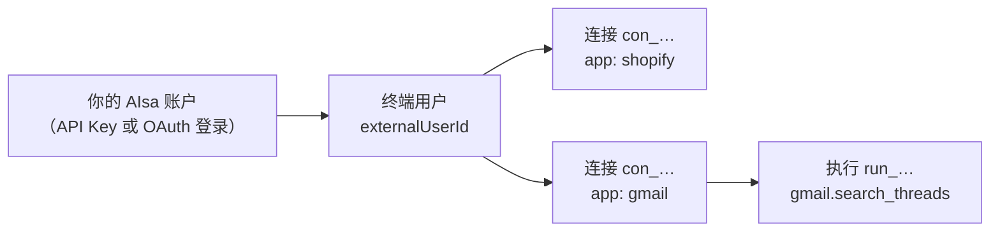

AIsa Connect 的对象模型很简单：你的**终端用户**通过**连接会话**或凭证，为某个**应用**建立**连接**；你再用这些连接执行应用的**动作**。



| 概念 | 含义 |
| --- | --- |
| **终端用户**（`externalUserId`） | **你自己系统里**的用户，用你自己的 ID 标识，不需要事先在 AIsa 注册。 |
| **应用** | 终端用户可以连接的应用，例如 `shopify`、`github`。`authTypes` 说明它的连接方式。 |
| **动作** | 应用能做的一件事，key 的格式是 `<app>.<动作名>`，例如 `shopify.get_shop`。每个动作有 `operationType` 和 `inputSchema`。 |
| **连接**（`con_…`） | 某个终端用户连接的一个应用账号，归属于“你的 AIsa 账户 + 这个 `externalUserId`”。 |
| **连接会话**（`cs_…`） | 一次托管 OAuth 授权流程，30 分钟后过期。 |
| **执行**（`run_…`） | 为某个终端用户执行一次动作。只有执行成功才收费。 |

## 终端用户

`externalUserId` 是终端用户在**你的系统里**的 ID，AIsa 用它区分你的不同终端用户。

- **格式：** 1–250 个可打印 ASCII 字符，首尾不能有空格。建议用稳定、不含个人信息的 ID，例如 `store_8812`，不要用邮箱。
- **何时必填：** 发起连接和执行动作时必填。查询连接列表时可选，用来过滤，按原样精确匹配（区分大小写）。
- **隔离：** 连接归属于你的 AIsa 账户**和**某一个 `externalUserId`。A 用户执行动作时，AIsa 不会用 B 用户的连接。
- **无需注册。** AIsa 不单独保存终端用户记录，这个 ID 只记在每个连接上。没有创建、列出或删除终端用户的接口；要看某个用户，就查他的连接。

<Warning>
`GET /connections/{connectionId}` 和 `DELETE /connections/{connectionId}` 只校验连接属于**你的 AIsa 账户**，不校验终端用户。请在你的后端保存“连接属于哪个终端用户”的对应关系，不要让终端用户自己传入任意连接 ID。
</Warning>

## 应用

应用是终端用户可以连接的东西，例如 `shopify`、`github`、`gmail`、`google_search_console`。应用 key 由小写字母、数字、`_` 和 `-` 组成。

| 字段 | 含义 |
| --- | --- |
| `key` | 应用 key，用在路径和动作 key 里 |
| `name`、`description` | 显示名称和简介 |
| `aliases` | 应用的其他叫法，`q` 也会搜索它们 |
| `categories` | `{id, name}` 形式的分类 |
| `authTypes` | 连接方式：`oauth2`、`api_key` 或 `custom_credential` |
| `iconUrl`、`homepageUrl`、`documentationUrl` | 给你的界面用的链接。`iconUrl` 可能是 `null` |

目录里不包含不需要用户账号的应用，也不包含 AIsa 用自有 API 提供的平台，例如 X（Twitter）、Instagram、LinkedIn、Reddit、YouTube、Meta、TikTok for Business 和 Google Ads。这些请用 [Unified API](/zh/resources/unified-apis)。

## 动作

动作是应用提供的一个操作，key 的格式是 `<app>.<动作名>`，例如 `shopify.list_orders` 或 `gmail.search_threads`。

| 字段 | 含义 |
| --- | --- |
| `key`、`app`、`name`、`description` | 标识和简介 |
| `operationType` | `read`、`write` 或 `destructive` |
| `requiredScopes` | 动作需要的应用权限，用应用自己的叫法 |
| `inputSchema` | 执行时 `input` 的 JSON Schema（draft 2020-12） |
| `outputSchema` | 执行成功时 `output` 的 JSON Schema |

目录会列出应用提供的全部动作。执行能否成功，还取决于已连接账号被授予的权限。见[执行动作](/zh/resources/aisa-connect/actions)。

## 连接

连接是某个终端用户连接的一个应用账号。用凭证连接时直接返回连接；托管授权完成后，会话里的 `connectionId` 就是它。

```json
{
  "id": "con_...",
  "app": "shopify",
  "externalUserId": "store_8812",
  "status": "active",
  "scopes": [],
  "connectedAt": "2026-11-12T08:00:00Z",
  "updatedAt": "2026-11-12T08:00:00Z"
}
```

- `status` 是 `active`、`needs_reconnect` 或 `disconnected`。见[管理连接](/zh/resources/aisa-connect/connections#连接状态)。
- `scopes` 是应用为这次授权报告的权限，可能为空，例如凭证类应用。
- 一个终端用户可以连接多个应用。如果同一个终端用户在同一个应用下有不止一个连接，不传 `connectionId` 的执行会使用最新的 `active` 连接。

## 连接会话

连接会话（`cs_…`）是某个终端用户、某个应用的一次托管 OAuth 授权流程。你发起会话，把用户带到 `connectUrl`，再轮询直到会话结束。会话 30 分钟后过期。见[为终端用户授权](/zh/resources/aisa-connect/authorize-users#托管授权页)。

## 托管 OAuth 和凭证

| | 托管 OAuth（`oauth2`） | 凭证（`api_key`、`custom_credential`） |
| --- | --- | --- |
| 谁输入什么 | 终端用户在 AIsa 托管授权页登录应用 | 终端用户在你的界面填写 key 或凭证，你的后端转交给 AIsa |
| 调用 | `GET /connect/{app}`，然后轮询 `GET /connect/sessions/{sessionId}` | 一次 `POST /connect/{app}/credentials` |
| 你的代码能否看到密钥 | 永远看不到 | 只在转交时经过你的后端，不要保存或记录 |
| 示例 | GitHub、Gmail、Google Search Console | Shopify（Admin API token）、WooCommerce、OpenAI |

有些应用支持不止一种连接方式，以应用的 `authTypes` 为准。

## 归属

AIsa Connect 里的一切都归属于**API Key 所在的 AIsa 账户**：

- 同一账户的所有 API Key 看到的是同一批连接；以该账户身份用 OAuth 登录的 MCP 或 CLI 客户端也一样。
- 账户之间完全隔离：一个 AIsa 账户永远看不到、也用不了另一个账户的连接。
- 你在[控制台](/zh/resources/aisa-connect/console)里建立的连接也属于同一账户，终端用户 ID 是 `console-user-<你的用户 ID>`。
- 目前没有连接的团队共享或按成员分配权限的机制。

## 鉴权

每个请求带上以下任意一种：

- `Authorization: Bearer YOUR_AISA_API_KEY`，或 `x-api-key: YOUR_AISA_API_KEY`。创建、限额和轮换 key 见[身份验证](/zh/guides/authentication)。
- MCP 或 CLI 登录得到的 OAuth access token，发送方式和 social 等走 MCP 的接口一致。用 OAuth 登录的 MCP 客户端不需要 key。

API Key 只能在你的后端使用，不要放进浏览器或移动端应用。

## 权限范围

AIsa Connect 有两个权限范围（scope）：

| Scope | 允许的操作 |
| --- | --- |
| `connector:read` | 浏览应用和动作、查询连接会话、列出和查询连接 |
| `connector:write` | 执行动作、发起连接（托管或凭证）、删除连接 |

API Key 默认两个都有。想把某个 key 限制为 Connect 只读，请联系 [developer@aisa.one](mailto:developer@aisa.one)，控制台里暂时没有这个设置。缺少所需权限范围的请求返回 `403 insufficient_scope`，`error.details.requiredScope` 写明缺的是哪一个。个人身份的 MCP 或 CLI 登录和你账户的 MCP key 权限范围相同，默认两个都有。以组织身份进行的 OAuth 登录始终可以读，但只有 token 被授予了 `connector:write`，才能执行动作、发起连接和删除连接。

这里的权限范围是 AIsa API 层面的权限，和终端用户在 OAuth 时授予应用的权限是两回事；后者决定应用允许一次执行做什么。
